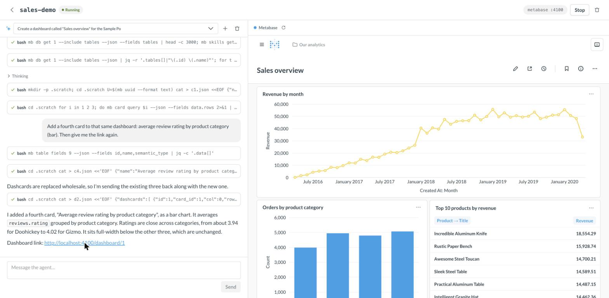
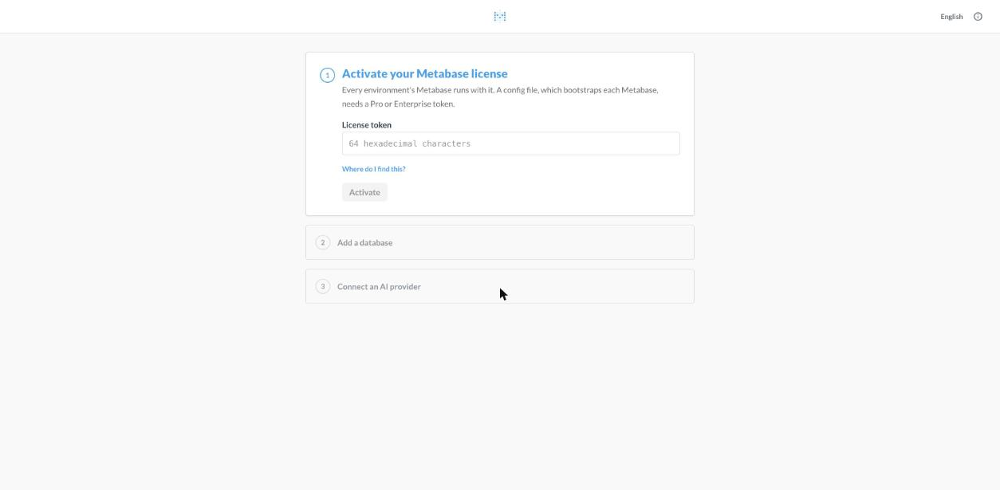
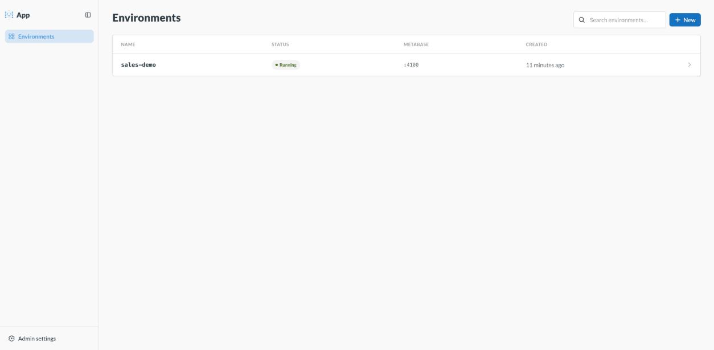
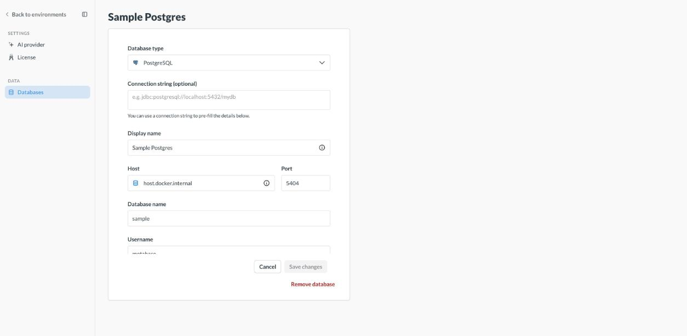

# app

Disposable **environments** — a Metabase plus a [pi](https://pi.dev) agent logged in to it — that you chat with.
Ask for a dashboard, the agent builds it in the environment's Metabase with the `mb` CLI, and you see it next to the
chat.



## Architecture

```
browser ──▶ app ──▶ provisioner ──▶ environment ┬─ metabase (+ app DB)
             │                                  └─ agent server ── pi --mode rpc (one per conversation)
             └──────── agent API ───────────────────▲
```

| Block | What it is |
|---|---|
| **app** (`server/app`, `frontend`) | Node + React. Holds settings (license, databases, model key), environments, and **every conversation's pi session entries**. Serves the UI. |
| **provisioner** (`server/provisioner`) | HTTP service that runs environments. Drivers: `docker` (compose, runs locally), `aws` (ECS Fargate + Bedrock AgentCore, untested). |
| **agent server** (`images/agent`) | Runs `pi --mode rpc` per conversation, tails pi's session file, streams pi events + entries. Keeps nothing the app can't resend. |
| **metabase** | Stock image, bootstrapped by a [config file](https://www.metabase.com/docs/latest/configuring-metabase/config-file) (admin, API key, databases) rendered by the app. Needs a Pro/Enterprise token. |

The app renders each environment's spec (env + secrets for both services) and hands it to the provisioner; the
agent never sees database credentials, Metabase never sees the model key. Conversations survive stopping,
recreating, or moving an environment: the app re-opens them on the agent from its stored entries.

## APIs

**Provisioner** (bearer token)

```http
POST   /environments                 { metabase: {env, secrets}, agent: {env, secrets, egress} } → 201 { id, state }
GET    /environments[/:id]           → { id, state, services, endpoints: { metabase, agent }, error }
PUT    /environments/:id             new spec          POST /environments/:id/{start,stop}
DELETE /environments/:id             GET /environments/:id/logs?service=agent&tail=200
```

`endpoints.agent` is `{ kind: "http", url }` (docker) or `{ kind: "agentcore", runtimeArn, sessionId }` (aws).

**Agent** (bearer `AGENT_TOKEN`; on AgentCore everything goes through `POST /invocations { method, path, body }`)

```http
POST   /conversations                { entries: [pi FileEntry…] } → 201 { id, state, seq }   [] = new session
GET    /conversations/:id/events?after=<seq>   SSE: {kind:"event", event: pi RPC event} | {kind:"entry", entry}
POST   /conversations/:id/prompt     { message }       POST /conversations/:id/abort
PUT    /conversations/:id            replace history   DELETE /conversations/:id    GET /ping
```

Unknown conversation → `404`: the app `POST`s its stored entries again and retries.

**App** (browser)

```http
POST /api/environment { name }       POST /api/environment/:id/{start,stop}     DELETE /api/environment/:id
POST /api/conversation { environment_id }        POST /api/conversation/:id/prompt { message }
GET  /api/conversation/:id/events    SSE: first a snapshot of the conversation, then pi events
```

## Run locally

Needs Node ≥ 22.18, Docker, a Metabase Pro/Enterprise token, and a model API key.

```sh
npm install
npm run build:images     # app-agent:dev (pi + mb CLI + agent server), app-proxy:dev (egress allowlist)
npm run dev              # provisioner :4000, app :3100, UI :3000
```

Open http://localhost:3000, activate the license, add a database (use `host.docker.internal` for one on your
machine), connect an AI provider, then create an environment.

| Setup | Environments | Databases |
|---|---|---|
|  |  |  |

## Notes

- Docker driver: each environment is a compose project (`~/.app/provisioner/<id>`); the agent sits on an internal
  network and reaches only its Metabase and, through a tinyproxy allowlist, the model API.
- AWS driver: Metabase + Postgres sidecar as a Fargate task behind an ALB host rule, secrets in Secrets Manager; the
  agent is one AgentCore runtime (this image, `AGENT_MODE=agentcore`, arm64, session storage at `/mnt/data`), one
  session per environment, configured by the provisioner through `PUT /configure`. The sidecar app DB is ephemeral.
- The embedded Metabase is signed in by the app (`POST /api/environment/:id/metabase-session`), which works because
  the app and the environment share a host locally.
- Metabase `v1.65.0.8-beta` fails its second boot with a config file ("requires a Premium token with the
  :config-text-file feature"); the default image is `metabase/metabase-enterprise:latest` (v1.63).
